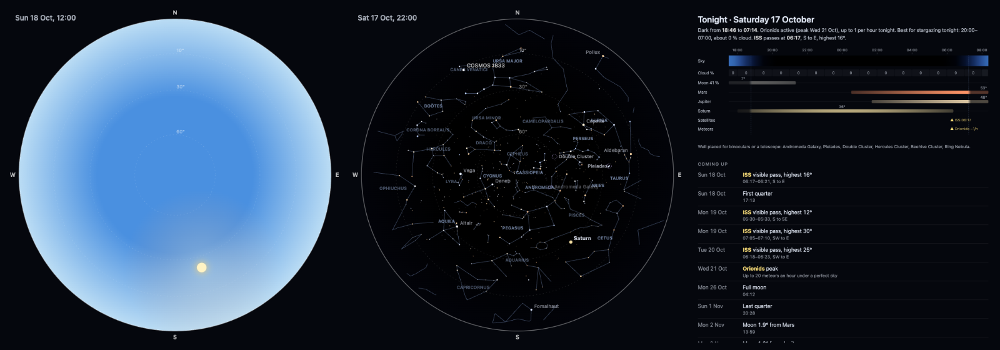

# ioBroker.skyorama

[](https://www.npmjs.com/package/iobroker.skyorama)
[](https://www.npmjs.com/package/iobroker.skyorama)


[](https://nodei.co/npm/iobroker.skyorama/)

**Tests:** 

## Skyorama adapter for ioBroker

Skyorama tells your smart home what is in the sky above it. It works wherever you live, and everything is worked out
for your own location:

- **Satellites**: visible passes of the ISS, Tiangong and up to 20 satellites of your choice, with an alert a few
  minutes before each pass.
- **Astronomy**: how dark it is, the moon, the five naked-eye planets, and a summary of what is worth looking at
  tonight. It also covers meteor showers, eclipses visible from home, and moon and planet events of the next 30 days.
  All of this is calculated locally.
- **Stargazing forecast**: when tonight will be clear, from an hourly cloud forecast.
- **Aurora**: whether the northern (or southern) lights can actually be seen from home right now: dark enough, near
  enough, and not overcast.
- **Aircraft**: the aircraft around you from an ADS-B source you configure, including emergencies, the nearest
  aircraft, and anything overhead. Front-ends can also follow one aircraft and get its route, airline and photo.
- **Lightning**: strikes near you from a lightning feed you configure, with an alert when a storm comes close.
- **Notifications**: alerts sent to Telegram, Pushover, e-mail, Signal and other messaging adapters, with a cooldown
  and quiet hours for each kind of event.
- **Three optional web pages**: a live sky dome, a flight map, and a "coming up" page with tonight's timeline and the
  events ahead.

Everything is available as ioBroker states for scripts, Blockly, VIS and other dashboards. Front-ends can also ask the
adapter directly through `sendTo`.



## Contents

- [Getting started](#getting-started)
- [Settings](#settings)
- [What each module does](#what-each-module-does)
- [The web pages](#the-web-pages)
- [Notifications](#notifications)
- [States](#states)
- [Messages (sendTo)](#messages-sendto)
- [Examples](#examples)
- [Data sources and privacy](#data-sources-and-privacy)
- [Questions and answers](#questions-and-answers)
- [Related adapters](#related-adapters)

## Getting started

Requirements: Node.js 22.13 or newer, js-controller 6.0.11 or newer, Admin 7.6.20 or newer. The web pages also need the
[web adapter](https://github.com/ioBroker/ioBroker.web).

1. Install Skyorama from the adapter list in Admin and create an instance.
2. **Location**: by default the adapter uses the latitude and longitude from the ioBroker system settings
   (System settings → Main settings). Untick the option to enter a different location.
3. Satellites and astronomy are on straight away and need no further setup. The first orbit set is fetched from
   CelesTrak within a few minutes of the first start.
4. Optionally:
   - check the **Aurora** tab (on by default; it fetches only around dusk and at night);
   - configure an aircraft source or a lightning feed (none is built in, see below);
   - add messaging instances on the **Notifications** tab;
   - switch on the web pages on the **Visualisation** tab.

Each module can be switched on or off on its own. Switching a module off keeps its objects, so history and alias
settings on them are not lost.

## Settings

| Tab | Setting | Default | Notes |
|---|---|---|---|
| Location | Use the system location | on | Otherwise enter latitude and longitude (decimal degrees, north and east positive) |
| Satellites | Track satellites | on | |
| | Additional CelesTrak groups | `visual` | Comma-separated [CelesTrak group names](https://celestrak.org/NORAD/elements/) for the orbit set given to front-ends. The ISS and Tiangong are always included |
| | Satellites to track | ISS, Tiangong | Up to 20, chosen from the current orbit set (the instance must be running to list them) |
| | Alert this many minutes before a pass | 10 | 1–120 |
| | Minimum pass height for an alert | 20° | 0–90; no alert for passes that stay lower |
| Astronomy | Sun, moon, planets and tonight's sky | on | Calculated locally |
| | Stargazing forecast | on | Cloud cover from [Open-Meteo](https://open-meteo.com/), every 2 hours |
| Aircraft | Aircraft (ADS-B) | off | See [Aircraft](#aircraft) |
| | Area source URL, lookup URL, lookup fallback URL, route lookup URL | empty | Your own sources |
| | Request header name and value | empty | For services that need an API key; the value is stored encrypted |
| | Background polling, radius, interval | off, 30 km, 60 s | Keeps the `aircraft.*` states up to date |
| | Overhead from | 45° | An aircraft at least this high in the sky counts as overhead |
| Aurora | Aurora | on | |
| | aurora-nowcast instance | `aurora-nowcast.0` | Its Kp index is added to the text when that adapter is installed; nothing happens if it is not |
| | Cloud cover limit | 60 % | With more cloud than this, the aurora counts as not visible |
| | Use AuroraWatch UK | off | UK only |
| Lightning | Lightning nearby | off | See [Lightning](#lightning) |
| | Broker URL, user name, password | empty | Your own feed; the password is stored encrypted |
| | Topic prefix | `blitzortung/1.1` | The usual prefix of Blitzortung-format feeds; change it if your feed uses another |
| | Strike radius, near radius | 300 km, 40 km | |
| Notifications | Messaging instances, events, recipients | none | See [Notifications](#notifications) |
| Visualisation | Sky pages | off | See [The web pages](#the-web-pages) |
| | Map tiles URL, attribution, dark map | empty, empty, on | For the flight map |

Values outside the allowed ranges are corrected by the adapter.

## What each module does

### Satellites

- Orbits (TLEs) come from [CelesTrak](https://celestrak.org/). They are fetched at most twice a day, at a random time,
  because CelesTrak blocks addresses that fetch the same data more often than every 2 hours. The last orbit set is
  kept, so a restart does not cause a new fetch. A change to the groups takes effect at most 2 hours after the last
  fetch.
- Visible passes are worked out for the next 72 hours for the satellites you track. A pass counts as visible when all
  three of these hold:
  - the satellite is lit by the sun;
  - it is at least 10° above the horizon;
  - the sun at your location is more than 6° below the horizon.
- An alert text is written a set time before each visible pass that gets high enough (defaults: 10 minutes, 20°). It
  says where to look, for example: "ISS visible from 19:42 for 6 min: from the SW, highest 54° in the SE at 19:45,
  towards the E". Each pass is alerted once, also across restarts.
- With the default `visual` group you can choose from the ISS, Tiangong and about 150 of the brightest satellites
  (Hubble, large rocket bodies and others).

### Astronomy

Calculated locally with [Astronomy Engine](https://github.com/cosinekitty/astronomy), with no internet access:

- **Darkness**: day, civil, nautical or astronomical twilight, or night.
- **The moon**: phase, illumination, elevation, next rise and set.
- **The planets** Mercury, Venus, Mars, Jupiter and Saturn: whether each is visible, its elevation, azimuth, next rise
  and set, and brightness.
- **Tonight's sky** (as JSON and one line of text):
  - when it is dark;
  - which planets are up and when they are highest;
  - the moon;
  - satellite passes;
  - bright deep-sky objects that are well placed, for example the Andromeda Galaxy or the Pleiades, and in the
    southern hemisphere also Omega Centauri and the Magellanic Clouds;
  - any active meteor shower;
  - the best hours from the stargazing forecast.
- **Meteor showers**: the nine major annual showers on the
  [IMO](https://www.imo.net/resources/calendar/) list (Quadrantids, Lyrids, Eta Aquariids, Southern Delta Aquariids,
  Perseids, Orionids, Leonids, Geminids, Ursids). For each active shower you get:
  - its peak date;
  - roughly how many meteors per hour you can expect tonight from your location, allowing for the height of the
    radiant, the distance from the peak and moonlight;
  - the best time to look.

  Outside the active windows, the next peak is named.
- **Eclipses**: the next solar eclipse and the next lunar eclipse that can actually be seen from your location (the sun
  or moon above the horizon at the time, penumbral lunar eclipses left out), with times and how much is covered.
- **Moon and planet events of the next 30 days**:
  - moon phases and supermoons;
  - the moon passing close to a planet (within 4°), and planets close to each other (within 2°);
  - oppositions of Mars, Jupiter and Saturn;
  - greatest elongations of Mercury and Venus.

### Stargazing forecast

Hourly cloud cover (total, low, mid and high) for your location from [Open-Meteo](https://open-meteo.com/), fetched
every 2 hours (part of the astronomy module, can be switched off). Each dark hour gets a score that counts cloud and
moonlight. The text names tonight's longest clear stretch, for example "Best for stargazing tonight: 21:00–02:00, about
10 % cloud", or says that it stays cloudy.

### Aurora

Whether the aurora can actually be seen from home now, not just whether there is a geomagnetic storm somewhere:

- **dark enough**: the sun more than 12° below the horizon;
- **near enough**: either of these:
  - the [NOAA SWPC OVATION](https://www.swpc.noaa.gov/products/aurora-30-minute-forecast) aurora forecast shows at
    least 10 % within 3° of latitude of you. This is usually poleward, where the aurora shows low on the horizon; at
    high latitudes it can also be overhead or to the south, and the text says where to look;
  - [AuroraWatch UK](https://aurorawatch.lancs.ac.uk/) is amber or red (optional, for the UK);
- **not overcast**: cloud cover at home from [Open-Meteo](https://open-meteo.com/) below a limit (default 60 %).

These are fetched only while it is getting dark or dark: OVATION every 10 minutes, cloud every 15, AuroraWatch UK
every 5. If the [aurora-nowcast](https://github.com/chrmenne/ioBroker.aurora-nowcast) adapter is installed, its Kp
index is added to the text. An alert text is written when the aurora turns possible, at most once every 6 hours.

### Aircraft

Skyorama has **no built-in aircraft data source**. You choose your own and enter its address in the settings, which
keeps you in charge of which services you use and on what terms. Aircraft is off by default. The adapter reads the
readsb/tar1090 JSON format:

- **Area source** (required): one of these:
  - your own receiver's `aircraft.json` ([readsb](https://github.com/wiedehopf/readsb), dump1090 or
    [tar1090](https://github.com/wiedehopf/tar1090));
  - an API URL with the placeholders `{lat}`, `{lon}` and `{radiusNm}` (or `{radiusKm}`), filled in from your location.
- **Aircraft lookup** (optional, with an optional fallback): one aircraft wherever it is, used when following it. It is
  a URL with `{hex}` and is asked at most once a second.
- **Route lookup** (optional): route files in the
  [VRS standing data](https://github.com/vradarserver/standing-data) format, a URL with `{callsign}` and `{prefix}`
  (the callsign's first two characters).
- **Request header** (optional): for services that need an API key. The value is stored encrypted and sent only to
  aircraft URLs on the same host as the area source.

Check the terms of any service you use: many free community feeds are for personal, non-commercial use and ask for
gentle request rates. Skyorama keeps its own rate low:

- nothing is polled unless something needs it, either a front-end asking through `sendTo`, or the optional background
  polling for the `aircraft.*` states;
- a front-end asking gets fresh data every 10 seconds at most, for the widest radius asked for in the last minute;
- the area source and the aircraft lookup (and its fallback) are left alone after a failure: from 2 seconds, doubling
  up to 5 minutes, and after a rate limit (HTTP 429) at least a minute, doubling up to 30 minutes, or as long as the
  service asks for with Retry-After (up to a day). Route lookups and photos are only asked when you open an aircraft's
  details.

Details for one aircraft are loaded only when asked for and cached (routes 1 day, photos 7 days):

- the route, from the route lookup if configured;
- a photo from [planespotters.net](https://www.planespotters.net/), returned with the photographer's name and a link,
  as their terms ask;
- the airline name, from the VRS standing data airline list.

Emergencies (an emergency status, or squawk 7500, 7600 or 7700) are flagged.

### Lightning

Strikes come from an MQTT feed that you configure, in the [Blitzortung.org](https://www.blitzortung.org/) format
(strike JSON published per geohash, one character per topic level):

- the broker URL (`mqtt://`, `mqtts://`, `ws://` or `wss://`);
- the topic prefix;
- an optional login (the password is stored encrypted).

The adapter subscribes only to the area around you (the geohash cells that cover the configured radius). Lightning is
off by default. Blitzortung data may be used for private, non-commercial purposes only; check the terms of the feed you
use.

The adapter keeps the strikes of the last hour within the radius. An alert text is written for the first strike within
the near radius (default 40 km) after half an hour without one.

## The web pages

Three optional pages, switched on in the **Visualisation** tab and served by the
[web adapter](https://github.com/ioBroker/ioBroker.web) at `/skyorama/`, for example
`http://<ioBroker>:8082/skyorama/`. That address links to all three. While the visualisation is off, the pages say so.
They work on phones, tablets and wall screens, and can be put on a VIS or other dashboard in an iframe.

URL parameters for all pages: `?instance=1` (another Skyorama instance) and `?units=km`, `mi` or `nm` (distances,
default km).

### The sky dome (`dome.html`)

The sky above home, with the zenith in the middle, the horizon at the edge and north at the top.

- The sky's colour follows the sun at your location: light blue by day, through sunset and twilight, to black at
  night.
- Stars, planets, constellation figures and deep-sky objects are drawn only when they could be seen: above the
  horizon and brighter than the sky allows right now. Twilight, moonlight and the extra air near the horizon all hide
  the fainter ones. The sun and moon are always shown when they are up, and the moon is drawn with its real phase and
  tilt.
- Satellites you track are always shown (faint when they can't be seen); other satellites only when they are
  visible. Aircraft are shown when an aircraft source is configured.
- On phones and tablets, the **Compass** button turns the dome so that its north points to real north. Browsers allow
  this only when the page is opened over HTTPS, and iOS asks for permission once.
- URL parameters:
  - `?radius=50`: aircraft radius, in the chosen units;
  - `?heading=90`: a fixed direction at the top, for example for a wall screen facing east;
  - `?figures=0`: no constellation figures;
  - `?labels=0`: no names;
  - `?at=22:00` (the next 22:00) or `?at=2026-10-24T22:00`: another time, within a week.
- The drawing code (`www/js/dome.js`) has no dependencies.

### The flight map (`map.html`)

The aircraft around home, with:

- their recent tracks and a one-minute heading line;
- colours by altitude, emergencies in red, and lost contacts greyed out;
- a choice of range;
- with the lightning module on, the strikes of the last hour.

Map tiles are optional. Enter a tile server URL with `{z}`, `{x}` and `{y}`, and the attribution its provider
requires; respect the provider's usage policy. **Dark map** (on by default) turns a light map style dark to suit the
page. Without a tile server, the map shows range rings on a dark background.

On the dome and the map, tap or click an aircraft for its details:

- what it is doing;
- its airline and a photo, with the photographer's credit;
- its route, if a route lookup is configured.

The details keep updating while the box is open. A tracked satellite shows its next visible pass.

### Coming up (`upcoming.html`)

Tonight from sunset to sunrise as one timeline:

- the sky's colour as on the dome;
- the cloud forecast hour by hour;
- when the moon and each planet are up, and how high they get;
- satellite passes and the best time for meteors.

Below the timeline is a dated list of what is coming up:

- satellite passes of the next three days;
- meteor shower peaks;
- moon phases and supermoons;
- close approaches of the moon and planets, oppositions and elongations;
- the next solar and lunar eclipses seen from home.

## Notifications

Every alert is a state, so you can build your own rules:

- `satellites.alert`
- `aurora.alert`
- `lightning.alert`
- `aircraft.emergencyText`

Skyorama can also send them itself. This is set up on the **Notifications** tab:

- a table of messaging instances, each with the events it should receive (satellite pass, aurora, lightning, aircraft
  emergency) and an optional recipient;
- a **Send a test notification** button (it uses the saved settings, so save first);
- for each event, a cooldown (at most one message in that time) and quiet hours (no messages, in the ioBroker host's
  time);
- optionally, the ioBroker notification system as well. These notifications are shown in Admin, and
  [notification-manager](https://github.com/foxriver76/ioBroker.notification-manager) passes them on to the messenger
  set up there.

Supported messaging adapters: pushover, telegram, email, signal-cmb, whatsapp-cmb, matrix-org, gotify, ntfy-client,
pushsafer, pushbullet, discord and synochat. Each gets the message in the form it expects. The recipient field
depends on the adapter:

- Discord: required, a user ID, a user name or `serverID/channelID`;
- email: the address (otherwise the adapter's default);
- Telegram: a user;
- ntfy: a topic.

Aircraft emergencies are sent only with background aircraft polling on.

## States

| State | Description |
|---|---|
| `info.connection` | All data sources in use are reachable (false until the first successful fetch, and after two failed attempts in a row) |
| `info.celestrak`, `info.forecast`, `info.noaa`, `info.openmeteo`, `info.aurorawatch`, `info.lightning` | Each source in use is reachable |
| `info.aircraftArea`, `info.aircraftLookup`, `info.aircraftLookup2` | The configured aircraft sources are reachable (written once a source has been used) |
| `satellites.alert` | Alert text, written shortly before a visible pass of a tracked satellite |
| `satellites.tle` | The orbit set (JSON `{ at, groups, sats: [[name, line1, line2], …] }`) |
| `satellites.<satellite>.visibleNow` | The satellite is visible right now. `<satellite>` is `iss`, `tiangong`, or `n` and the catalogue number, for example `n20580` for the Hubble Space Telescope |
| `satellites.<satellite>.passes` | Visible passes in the next 72 hours (JSON; passes already alerted are marked `alerted`) |
| `satellites.<satellite>.next.*` | The next visible pass: `start`, `end`, `maxEl`, `maxAt`, `fromAz`, `toAz`, `text` |
| `astronomy.darkness` | `day`, `civil`, `nautical`, `astronomical` or `night` |
| `astronomy.moon.*` | `phase`, `illumination` (%), `elevation` (°), next `rise` and `set` |
| `astronomy.planets.<name>.*` | `visible`, `elevation`, `azimuth`, next `rise` and `set`, `magnitude` |
| `astronomy.tonight`, `astronomy.tonightText` | Tonight's sky as JSON and as one line of text |
| `astronomy.meteors`, `astronomy.meteorsText` | Active meteor showers (peak, rate tonight, best time) or the next one |
| `astronomy.eclipses`, `astronomy.eclipsesText` | The next solar and lunar eclipses seen from home |
| `astronomy.events`, `astronomy.eventsText` | Moon and planet events of the next 30 days (JSON `[{ at, type, text }]`, `type` is `moonPhase`, `supermoon`, `conjunction`, `opposition` or `elongation`); the text names the next three |
| `astronomy.forecast`, `astronomy.forecastText` | Hourly cloud forecast with a stargazing score (JSON), and tonight's best hours |
| `aurora.possible` | The aurora can be seen from home now (dark, near enough, not overcast) |
| `aurora.reason`, `aurora.summary` | Why or why not, and one line of text, for example "Unlikely from home: not dark" |
| `aurora.inputs` | Everything the decision used (JSON) |
| `aurora.alert` | Alert text, written when the aurora turns possible (at most every 6 hours) |
| `aircraft.count` | Aircraft within the background radius (background polling only, like all `aircraft.*` states) |
| `aircraft.overhead` | An airborne aircraft is at least the set angle above the horizon |
| `aircraft.nearest.*` | Nearest airborne aircraft: `callsign`, `type`, `registration`, `altitude` (ft), `distance` (km), `bearing` (°), `elevation` (°) |
| `aircraft.emergency`, `aircraft.emergencyText` | An aircraft is reporting an emergency (or squawking 7500, 7600 or 7700), and a description |
| `aircraft.list` | The aircraft within the background radius (JSON, same fields as the `aircraft` message) |
| `lightning.nearestKm`, `lightning.count1h` | Nearest strike (km) and number of strikes within the radius in the last hour |
| `lightning.lastNearAt` | Time of the latest strike within the near radius |
| `lightning.strikes` | The newest strikes (up to 1000) within the radius in the last hour, updated at most once a minute (JSON `{ at, radiusKm, total, strikes: [{ lat, lon, t, km }] }`) |
| `lightning.alert` | Alert text for the first near strike after a quiet half hour |

Times are timestamps in milliseconds. A value that does not exist (for example no moonrise in the polar summer) is
`null`. Texts are in English. Dates and times in texts use the ioBroker host's time zone.

## Messages (sendTo)

Front-ends and scripts can ask the adapter directly. Every message gets an answer; errors come back as `{ error }`.

| Command | Message | Answer |
|---|---|---|
| `tle` | none | `{ at, groups, sats: [[name, line1, line2], …] }`: the orbit set, for drawing satellites |
| `aircraft` | `{ radiusNm }` (1–250, default 40) | `{ at, radiusNm, ac: [...] }`, nearest first: `hex`, `flight`, `reg`, `type`, `lat`, `lon`, `alt` (ft, 0 = on the ground), `gs` (kn), `track`, `dst` (nm), `dir` (bearing from home), `vr` (ft/min), `selAlt`, `squawk`, `emergency`, `stale`, `trail` (`[[lat, lon, alt], …]`, the last 15 minutes) |
| `follow` | `{ hex }` | `{ at, found, ac }`: where the aircraft is now, wherever it is: `lat`, `lon`, `altGeom` (GNSS height, ft), `altBaro`, `gs`, `track`, `heading`, `roll`, `vr`, `seenPos`, `flight`, `reg`, `type`, `squawk`, `emergency`. Keep asking every few seconds while you follow it |
| `lookup` | `{ hex, flight, reg, lat, lon }` | `{ airline, route, photo }`: `route` is `{ from, to, fromName, toName, plausible, fromPos, toPos }` or null; `photo` is `{ src, link, by }` or null |
| `sky` * | `{ at }` (optional, within a week) | The sky at that moment: sun, moon (with its phase), planets, the satellites above the horizon, and the visible passes |
| `upcoming` * | none | Tonight (as in `astronomy.tonight`), a sunset-to-sunrise timeline of sun, moon and planet altitudes, the forecast, meteor showers, eclipses, events and the satellite passes still to come |
| `mapConfig` * | none | `{ home, tiles, attribution, dark, aircraft, lightning }` for drawing a map |
| `lightning` * | none | `{ at, radiusKm, total, strikes }`, as in `lightning.strikes` but current |

\* These answer only while the visualisation is switched on.

## Examples

Announce a satellite pass on a smart speaker (JavaScript adapter):

```js
on({ id: 'skyorama.0.satellites.alert', change: 'ne' }, obj => {
    if (obj.state.val) setState('alexa2.0.Echo-Devices.XXXX.Commands.speak', obj.state.val);
});
```

Tonight's sky in a morning or evening message:

```js
schedule('0 19 * * *', async () => {
    const tonight = (await getStateAsync('skyorama.0.astronomy.tonightText')).val;
    sendTo('telegram.0', 'send', { text: tonight });
});
```

Close the roof window when lightning comes near:

```js
on({ id: 'skyorama.0.lightning.nearestKm', change: 'ne' }, obj => {
    if (obj.state.val !== null && obj.state.val < 15) setState('my.roofwindow.close', true);
});
```

Aircraft nearby, from a script:

```js
sendTo('skyorama.0', 'aircraft', { radiusNm: 20 }, result => {
    if (result.error) return log(result.error, 'warn');
    for (const a of result.ac) log(`${a.flight || a.hex} at ${a.alt} ft, ${a.dst} nm`);
});
```

## Data sources and privacy

Skyorama only contacts the services that the modules you switch on need. It sends them your location only where the
service needs it. The aircraft and lightning sources are the ones you enter yourself.

| Source | Used by | Sent | How often |
|---|---|---|---|
| [CelesTrak](https://celestrak.org/) | Satellites | Group names | At most twice a day |
| [Open-Meteo](https://open-meteo.com/) | Stargazing forecast, aurora | Your location (3 decimals) | Every 2 hours (forecast); every 15 minutes while getting dark or dark (aurora) |
| [NOAA SWPC](https://www.swpc.noaa.gov/) | Aurora | Nothing | Every 10 minutes while getting dark or dark |
| [AuroraWatch UK](https://aurorawatch.lancs.ac.uk/) | Aurora (optional) | Nothing | Every 5 minutes while getting dark or dark |
| Your aircraft sources | Aircraft | Your location and radius (area source), aircraft addresses and callsigns (lookups) | Only while asked, or at your background interval |
| [planespotters.net](https://www.planespotters.net/) | Aircraft details | Aircraft address or registration | When the details of an aircraft are opened, cached for 7 days |
| VRS standing data airline list | Aircraft details | Nothing | Once a day, when details are used |
| Your lightning feed | Lightning | The geohash cells around you (subscriptions) | A permanent connection |
| Your messaging adapters | Notifications | The alert text | Per alert, within your cooldown and quiet hours |

Astronomy (apart from the forecast) is calculated locally.

## Questions and answers

**Why is there no aircraft or lightning source built in?** The good free feeds are community projects with their own
terms (usually personal, non-commercial use) and limited capacity. Pointing every installation at them by default
would not be fair to them, so you choose your own source and accept its terms yourself. A local ADS-B receiver
(readsb, dump1090, tar1090) works well and needs no internet access at all.

**The satellite list in the settings is empty.** It is filled from the current orbit set, so the instance must be
running and have fetched the orbits once. Wait a few minutes after the first start, then reopen the settings.

**A pass was announced but I couldn't see it.** Low passes (below 20°) are easily hidden by buildings and trees, and
haze near the horizon hides them too. Raise the minimum pass height for alerts.

**The compass button does nothing on my phone.** Browsers allow the compass only on pages opened over HTTPS. Switch
on HTTPS in the web adapter, or use the dome without it (north at the top).

**`info.connection` is false.** One of the sources in use failed twice in a row. The `info.*` states show which one;
the log has the reason.

**Can I use it in VIS?** Yes. Use the states directly, or embed a page with an iframe/HTML widget, for example
`/skyorama/dome.html?labels=0`. VIS-2 widgets are planned.

## Related adapters

- [JetFrame](https://github.com/backfisch88/ioBroker.jetframe) is a complete plane-spotting display: it shows the
  aircraft passing your window, with photos, runway detection and daily statistics in its own web app. Use it if that
  is what you want. Skyorama's aircraft module is a data source instead: states for automations and a `sendTo` API for
  your own dashboards and maps, next to the rest of the sky.
- [aurora-nowcast](https://github.com/chrmenne/ioBroker.aurora-nowcast) provides the aurora probability at your
  location, the Kp index and solar wind data. Skyorama's aurora module adds "can I see it from here now" (darkness,
  cloud, aurora low on the horizon) and uses aurora-nowcast's Kp when it is installed.

## Credits

- Astronomy: [Astronomy Engine](https://github.com/cosinekitty/astronomy) by Don Cross (MIT).
- Satellite orbits: [satellite.js](https://github.com/shashwatak/satellite-js) (MIT); TLEs from
  [CelesTrak](https://celestrak.org/).
- Star positions: the Yale Bright Star Catalogue (5th ed.), as converted by
  [brettonw/YaleBrightStarCatalog](https://github.com/brettonw/YaleBrightStarCatalog) (MIT, Bretton Wade).
- Constellation figures: [d3-celestial](https://github.com/ofrohn/d3-celestial) by Olaf Frohn (BSD-3-Clause). Both
  notices are in `www/js/skydata.js`.
- Map: [Leaflet](https://leafletjs.com/) (BSD-2-Clause, included in `www/lib/leaflet`).
- Meteor shower data: the [International Meteor Organization](https://www.imo.net/) working list.

## Roadmap

- VIS-2 widgets for the dome, the map and the timeline.

## Changelog
<!--
    Placeholder for the next version (at the beginning of the line):
    ### **WORK IN PROGRESS**
-->

### **WORK IN PROGRESS**
* (Alan Paris) Satellites (ISS and Tiangong passes, pass alerts, orbit set) and astronomy (darkness, moon, planets, tonight's sky)
* (Alan Paris) Aircraft: nearby aircraft, following one aircraft and aircraft details for front-ends, optional background states
* (Alan Paris) Aurora (visible from home now?) and lightning nearby (Blitzortung)
* (Alan Paris) Optional sky dome page (www): the sky above home as you would see it, with aircraft and satellites
* (Alan Paris) Optional flight map page (www), and details for an aircraft or satellite on both pages
* (Alan Paris) Aircraft and lightning sources are configured by the user (URLs, optional API header, broker login); none built in
* (Alan Paris) Choose up to 20 satellites for passes and alerts (ISS and Tiangong by default)
* (Alan Paris) Notifications to messaging adapters and ioBroker notifications, with cooldown and quiet hours per event
* (Alan Paris) Meteor showers, eclipses seen from home, moon and planet events, stargazing cloud forecast, and an "upcoming" page (www)
* (Alan Paris) Aircraft sources back off much longer after failures and rate limiting (honouring Retry-After)

### 0.0.1 (2026-10-17)
* (Alan Paris) initial release

## License
MIT License

Copyright (c) 2026 Alan Paris <alan.paris@scottish.rugby>

Permission is hereby granted, free of charge, to any person obtaining a copy
of this software and associated documentation files (the "Software"), to deal
in the Software without restriction, including without limitation the rights
to use, copy, modify, merge, publish, distribute, sublicense, and/or sell
copies of the Software, and to permit persons to whom the Software is
furnished to do so, subject to the following conditions:

The above copyright notice and this permission notice shall be included in all
copies or substantial portions of the Software.

THE SOFTWARE IS PROVIDED "AS IS", WITHOUT WARRANTY OF ANY KIND, EXPRESS OR
IMPLIED, INCLUDING BUT NOT LIMITED TO THE WARRANTIES OF MERCHANTABILITY,
FITNESS FOR A PARTICULAR PURPOSE AND NONINFRINGEMENT. IN NO EVENT SHALL THE
AUTHORS OR COPYRIGHT HOLDERS BE LIABLE FOR ANY CLAIM, DAMAGES OR OTHER
LIABILITY, WHETHER IN AN ACTION OF CONTRACT, TORT OR OTHERWISE, ARISING FROM,
OUT OF OR IN CONNECTION WITH THE SOFTWARE OR THE USE OR OTHER DEALINGS IN THE
SOFTWARE.